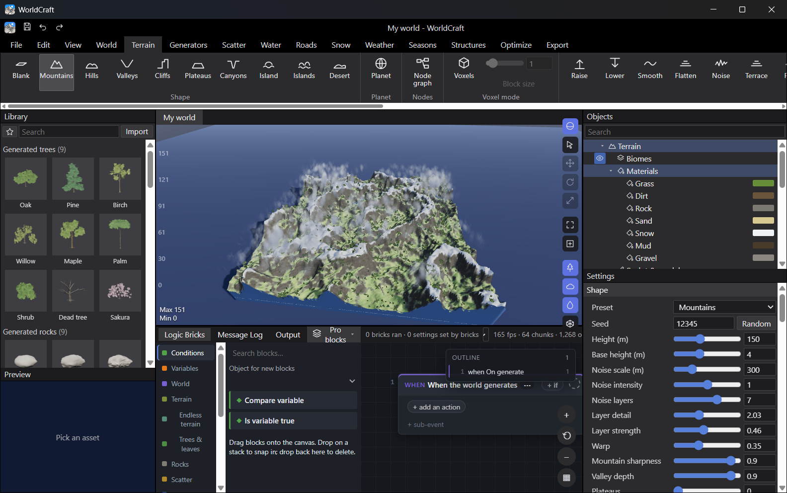
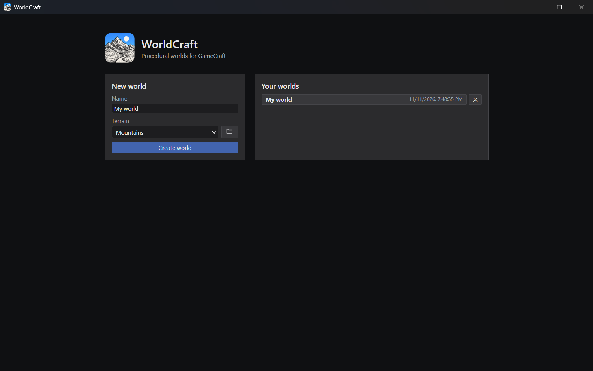

# WorldCraft

**Procedural worlds for GameCraft: terrain, water, trees, roads, weather and structures from a seed.**

Procedural worlds for GameCraft. Run `WorldCraft.exe` (needs the WebView2 runtime, included with Windows 10/11).

- **Terrain:** presets, noise, erosion, sculpting, painting, stamps, holes; finite or endless (chunks stream round the camera).
- **Looks:** realistic, stylized, toon or pixel-art trees, leaves, grass and rocks, never mixed, or Mixed: a look to each region.
- **Trees, rocks, scatter, biomes:** generated or your own assets, all from seeds: the same seed gives the same world. Every tree and rock comes in several random shapes.
- **Your own trees:** change a placed tree's leaf type, give it a new shape, move its branch nodes, or draw a tree's trunk and branches by hand.
- **Water, roads, caves:** sea, rivers and lakes are one water, in channels and basins cut for them; roads in gravel, cobbles, brick, planks, asphalt and more; smooth rock caves.
- **Snow, seasons, weather, effects:** SpriteCraft's rain and snow, clouds of many kinds, and ParticleCraft's and SpriteCraft's effects to place.
- **Structures:** your imported buildings, always at the same spots for a seed, even in endless worlds.
- **Logic:** the same block editor as GameCraft. World bricks under "When the world generates" drive every generator.
- **Export:** to GameCraft (import it from Import scene), or baked .glb and heightmap for Blender, Godot and Unity.

Worlds are saved in `%LOCALAPPDATA%\CraftApps\WorldCraft`.

See `BUILD_STATUS.md` in the source for what is finished and what is not yet.



## Download

Get the latest version from the [Releases page](https://github.com/DFairGamz/WorldCraft/releases/latest):

| File | What it is |
|---|---|
| `WorldCraft-1.0.0-setup.exe` | **Recommended.** Installs for your Windows account (no administrator rights), adds Start menu and desktop shortcuts, and can be removed from *Settings › Apps*. |
| `WorldCraft-1.0.0-windows-x64.zip` | Portable. Unzip anywhere and run `WorldCraft.exe`. |

Windows 10 or 11, 64-bit. The program isn't code-signed yet, so Windows SmartScreen may warn the first
time: choose **More info › Run anyway**.



## Build from source

Needs [Node.js](https://nodejs.org/) 20 or later and [Rust](https://rustup.rs/) (stable, MSVC toolchain on
Windows). This repository holds the app together with the shared code it uses (`Shared/`), and the GameCraft code it reuses (`GameCraft/src`).

```powershell
powershell -ExecutionPolicy Bypass -File build.ps1
```

`build.ps1` installs the npm packages, builds the interface, compiles the desktop program and writes the
portable folder to `Windows\WorldCraft` and the zip to `public\`. For a development server with hot reload,
run `npm run dev` in `WorldCraft\`.

## License

WorldCraft is licensed under **MIT OR Apache-2.0** ([LICENSE-MIT](WorldCraft/LICENSE-MIT),
[LICENSE-APACHE](WorldCraft/LICENSE-APACHE)). Third-party code and assets are credited in
[NOTICE.md](packaging/WorldCraft/NOTICE.md) and [THIRD_PARTY_NOTICES.md](THIRD_PARTY_NOTICES.md).
